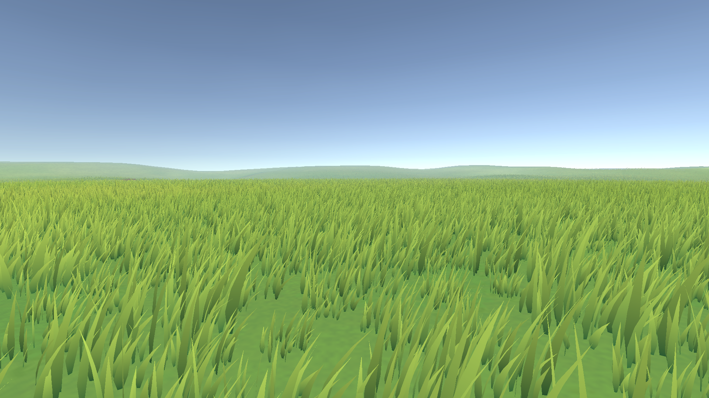

# Endless Meadow (URP)

GPU stylized grass for Unity Terrain: hand-painted-style blade clumps, wind waves that push the grass over, and per-blade motion. Generated and culled on the GPU, so large meadows stay fast.

## Features

- **Leaf-shaped blades**: narrow root, widest just above it, pointed tip; random height, width, lean and curl.
- **Wind**: travelling gust waves bend the grass over and lighten it; world-space noise breaks up the wave fronts; every blade has its own stiffness and flutter.
- **Colour**: dark root → bright tip, yellow-tipped patches, back-light translucency, root darkening, soft "normals up" canopy lighting.
- **Lighting**: receives real-time sun shadows; uses Unity's fog so the grass blends with terrain and sky.
- **Fast**:
  - roots generated once on the GPU (compute shader), no GameObjects or per-blade CPU work;
  - each camera only culls the grid cells around itself (frustum + distance);
  - five distance bands, each drawn with a clump mesh that only contains the blades that band still shows (24 → 17 → 12 → 9 → 6 blades by default);
  - dithered fade at the draw distance, no popping.
- **Ray-marched far grass to the horizon**: beyond the blade draw distance the meadow continues as a lightweight ray-marched grass canopy. A ring mesh around the camera (one draw call) sits on the canopy top; each pixel marches a few steps (default 12) down through the grass slab to the ground, with upright-blade extinction, tapering blade density and the blades' own colour and lighting by height. Looking across the field you see dense, bright tips; looking down you see darker lower blades and the ground between them; distant hill crests get a soft grass silhouette. The canopy top rises and falls in tufts (bright tops, dark gaps between them), and far away it keeps at least a few pixels of height on screen, so the meadow keeps its depth all the way out instead of turning into flat paint. Same wind waves, grass layers and slope limit as the blades, and it fades in exactly where they fade out.
- **Terrain layers decide where grass grows**: tick the grass layers in the *Grass layers* dropdown; painting an unticked layer (the demo's *Dirt Path*) clears grass. *Fine-tune amounts* gives each layer a 0–100 % slider for sparse grass.
- **Live terrain editing**: sculpting and painting the terrain update the grass immediately (it reads the terrain's GPU heightmap and splat maps). *Show In Scene View* hides the grass in the Scene view only, to see the bare terrain.
- Works in **Edit mode** and the **Scene view**, and with several cameras.

## Requirements

- Unity 6 (6000.0+) with **URP** 17+
- A platform with compute shaders and indirect drawing (DX11/DX12, Vulkan, Metal)
- Tested on Unity 6000.3 / URP 17.3 / DX12

## Quick start

1. Copy the `EndlessMeadow` folder into your project's `Assets` folder.
2. **Demo**: menu **GameObject ▸ Endless Meadow ▸ Create Demo Scene**, then press Play.
   Right mouse: look · WASD: move · Q/E: down/up · Shift: fast · G: walk · F12: screenshot.
3. **Your own terrain**: select it, then **GameObject ▸ Endless Meadow ▸ Add Grass To Selected Terrain**
   (also in the Hierarchy right-click menu; or add the *Meadow Grass* component to any GameObject and assign the terrain).

Sculpt and paint the terrain as usual: the grass follows automatically. **Frame Terrain in Scene View** points the Scene view at the terrain (and turns off Scene-view fog).

## Settings (Inspector)

| Group | What it controls |
|---|---|
| Placement | Clumps per m², maximum slope that still gets grass, seed |
| Grass on terrain layers | *Grass layers* dropdown (tick the layers grass grows on); *Fine-tune amounts* for 0–100 % per layer |
| Shape | Height, random height/width ranges, per-blade height, blades per clump, clump radius, blade width, root width, widest point |
| Colour | Root / tip / patch colours, patch size and strength, per-blade brightness, translucency, normals-up, root darkening |
| Wind | Strength, speed, direction, wave spacing, gust bend, wave brightness, wave noise, per-blade sway variation |
| Distance and performance | Draw distance, fade length, blade LOD start/end and how many blades stay far away, root cap, show in Scene view |
| Far grass | *Far Grass* on/off, *Far Distance* (how far the far layer reaches, default 1500 m), *Far Steps* (ray-march steps per pixel, 4–24, default 12) |

## Performance tips

- The biggest costs are the number of visible blades and the draw distance. Lower **Blades Per Clump**, **Draw Distance** or **LOD End** first.
- **Density** × terrain area = roots in memory (16 bytes each). A 600 m × 600 m terrain at 1.4/m² is ~0.5 M roots (8 MB).
- **Far Grass** costs one draw call plus a short ray march per far pixel; it lets you keep **Draw Distance** short (the blades are the expensive part) while the meadow still reaches the horizon. Lower **Far Steps** on slow GPUs.

## Notes and limits

- One terrain per component (add more components for more terrains).
- Grass does not cast shadows (receiving only), by design for speed.
- No interaction (trampling) in this lite version. Up to 8 terrain layers are read for grass amounts.

## License

MIT License, Copyright (c) 2026 Parrot222. See [LICENSE](LICENSE.md).
